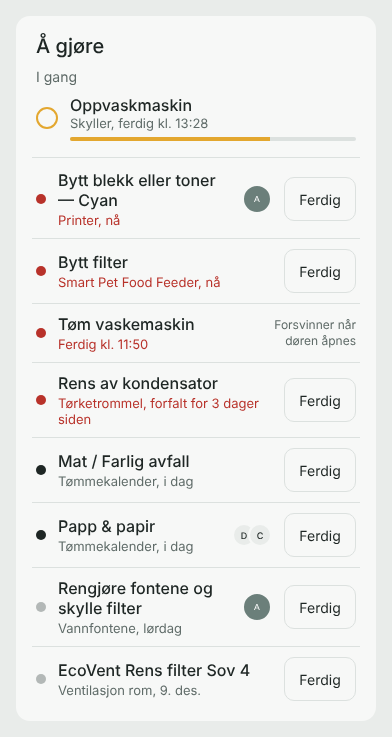

# Home Tasks Card

A Home Assistant card that shows everything that needs doing in the house in one list, made for a shared wall tablet.



- **In progress:** appliances that are running, with phase, finish time and progress.
- **To do:** [Maintenance Supporter](https://github.com/iluebbe/maintenance_supporter) tasks that are due soon, overdue or triggered, plus appliances that are finished but not emptied.
- **Calendars, to-do lists and dates:** birthdays and appointments from any calendar, open items from any to-do list, and entities that hold a date (a yearly one shows the age), sorted into the same list.
- **Spare parts:** the done dialog shows the parts Maintenance Supporter books for the task and how many are in stock.
- **Who did it:** tapping **Done** asks who did the task, so completions are recorded on the right person even when the tablet is logged in as one shared user. Maintenance Supporter's rotation depends on this.
- **Skip:** hold a task to skip it this time, with an optional reason.

The card owns no state. It reads `hass.states`, fetches calendar events and to-do items, and calls Maintenance Supporter's `complete` and `skip` services and `todo.update_item`.

## Requirements

- Home Assistant 2024.11 or newer
- [Maintenance Supporter](https://github.com/iluebbe/maintenance_supporter) for tasks
- Optional: Home Connect, or any entities that tell whether an appliance is running and finished

## Installation

### HACS / Marketplace (custom repository)

Add `https://github.com/trikkssitt/home-tasks-card` as a **Dashboard** repository, install **Home Tasks Card** and reload the browser.

### Manual

Copy `dist/home-tasks-card.js` to `/config/www/` and add the resource `/local/home-tasks-card.js?v=0.2.0` as a **JavaScript module**. Change `?v=` on every update.

## Configuration

```yaml
type: custom:home-tasks-card
title: Å gjøre
max_items: 8
persons:                       # order in the "who did it" picker
  - person.anders
  - person.berit
  - person.cecilie
  - person.david
exclude_objects: [Motorsykkel, Elbil, Batteriflåte]
appliances:
  - name: Vaskemaskin
    type: home_connect
    prefix: vaskemaskin        # sensor.vaskemaskin_operation_state etc.
    icon: mdi:washing-machine
    overdue_after: 60          # minutes before "empty it" turns red
  - name: Oppvaskmaskin
    type: entities
    icon: mdi:dishwasher
    running: { entity: binary_sensor.oppvaskmaskin_running, state: "on" }
    phase: sensor.oppvaskmaskin_navaerende_fase
    remaining: sensor.oppvaskmaskin_time_remaining   # minutes
    progress: sensor.oppvaskmaskin_progress          # percent
    finished: { entity: input_select.oppvaskmaskin_status, state: Ferdig }
    overdue_after: 720
    emptied_action:
      action: input_select.select_option
      target: { entity_id: input_select.oppvaskmaskin_status }
      data: { option: Avsluttet }
calendars:
  - entity: calendar.bursdager
    days_ahead: 14
  - entity: calendar.familie
    name: Familien
todo_lists:
  - entity: todo.husarbeid
    days_ahead: 7              # undated items still show
dates:
  - entity: input_datetime.berit_bursdag
    name: Berit har bursdag
    yearly: true               # next anniversary, with the age
    persons: [person.berit]
  - entity: input_datetime.eu_kontroll   # overdue once passed
```

### Card options

| Option | Default | Description |
| --- | --- | --- |
| `title` | translated "To do" | Card title. |
| `max_items` | `8` | Rows before "+N more". |
| `ask_who` | `true` | Ask who did a task. `false` records the logged-in user. |
| `persons` | every `person.*` linked to a user | People in the picker. |
| `exclude_objects` | none | Maintenance Supporter objects (`parent_object`) to hide. |
| `include_statuses` | `[due_soon, overdue, triggered]` | Task statuses to show. |
| `appliances` | none | See below. |
| `calendars` | none | See [Calendars](#calendars). |
| `todo_lists` | none | See [To-do lists](#to-do-lists). |
| `dates` | none | See [Dates](#dates). |
| `language` | Home Assistant's language | `nb` or `en`. |

### Appliances

| Option | Description |
| --- | --- |
| `name` | Display name. |
| `type` | `home_connect` (default) or `entities`. |
| `prefix` | `home_connect`: entity prefix. Reads `sensor.<prefix>_operation_state`, `_program_progress` and `_program_finish_time`. |
| `running` | `entities`: `{entity, state}` that means running. |
| `finished` | `entities`: `{entity, state}` that means finished and not emptied. |
| `phase`, `remaining`, `progress` | `entities`: optional sensors for phase text, minutes left and percent. |
| `overdue_after` | Minutes after finishing before the row turns red. Default `60`. |
| `emptied_action` | Action run by the **Emptied** button. Without it no button is shown; Home Connect machines clear themselves when the door is opened. |
| `icon` | Icon in "In progress". |

### Calendars

Events from now until `days_ahead` days ahead. An event has no button: it disappears when it is over. Timed events show the time, and an event that is happening says "Now". Events are fetched when the card loads, every 15 minutes, at midnight and when the calendar entity changes.

| Option | Default | Description |
| --- | --- | --- |
| `entity` | required | A `calendar.*` entity. |
| `name` | the entity's name | Shown before the date, as the object is for tasks. |
| `days_ahead` | `7` | How far ahead to show events. |
| `persons` | none | People whose faces are shown on the rows. |

### To-do lists

Open items from a Home Assistant to-do list (Local To-do, Google Tasks, the shopping list...). **Done** marks the item completed with `todo.update_item`. To-do lists do not record who did it, so the card does not ask.

| Option | Default | Description |
| --- | --- | --- |
| `entity` | required | A `todo.*` entity. |
| `name` | the entity's name | Shown before the date. |
| `days_ahead` | all | Items due further ahead wait. |
| `show_undated` | `true` | Show items without a due date (sorted last). |
| `persons` | none | Faces on the rows. |

### Dates

Entities whose state is a date: `input_datetime` (with date), date sensors and timestamp sensors. There is no button; change the entity to make the row go away.

| Option | Default | Description |
| --- | --- | --- |
| `entity` | required | The entity. |
| `name` | the entity's name | Row title. |
| `yearly` | `false` | Show the next anniversary. With a year before this one in the date, the row says how old (`I morgen, 40 år`). Without `yearly`, a date that has passed shows as overdue. |
| `days_ahead` | `14` | How far ahead to show it. |
| `persons` | none | Faces on the row. |

### Spare parts

When a task is linked to spare parts in Maintenance Supporter, completing it takes them off the stock. The done dialog lists those parts and the stock, read from Maintenance Supporter's `maintenance_supporter/objects` command when the dialog opens. Parts that a task phase overrides are not shown. Choosing other parts than the linked ones needs `used_parts` on the `complete` service, which Maintenance Supporter does not have yet.

### Theming

No hard-coded colors. The card follows the theme; these variables can be overridden:

| Variable | Default | Used for |
| --- | --- | --- |
| `--todo-alert-color` | `--error-color` | Overdue dot and text. |
| `--todo-active-color` | `--state-active-color` | Progress bar and running icon. |
| `--todo-muted-color` | `--secondary-text-color` | Secondary text and later tasks. |
| `--todo-divider-color` | `--divider-color` | Lines between rows. |

## Development

```sh
npm test    # model tests against real states, no dependencies
```

`test/harness.html` renders the card with the test fixtures in light and dark (serve the repo folder over HTTP).

## License

MIT
